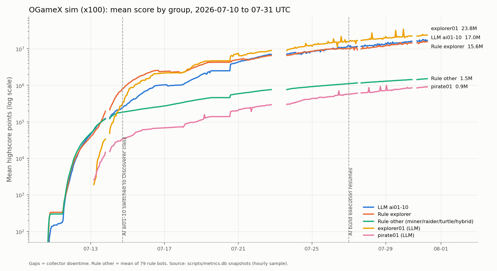

# v1 실험 평가 (2026-07-10 ~ 07-31)

7월에 리눅스 PC 한 대에서 돌린 OGameX 봇 유니버스(v1)를 2026-10-30에 다시 분석한 결과다.

## 한 줄 결론

LLM 봇(ai01~10)이 규칙봇 평균보다 5배 높은 점수로 끝났지만, **LLM의 판단 덕이 아니라 7/14에 LLM 계정만 탐험가 클래스로 바꾼 효과**다. 같은 탐험가 클래스 규칙봇과 비교하면 차이가 없다. "LLM이 규칙봇보다 잘하나?"는 v1으로는 답할 수 없다.

## v1 구성

- 서버: OGameX(upstream `lanedirt/ogamex`, 덤프 기준 커밋 `5236752e8d`)를 Docker로 로컬 실행, 고배속
- 봇 102명
  - 규칙봇 90명: 성격 5종(아래 표), 이메일 해시로 고정 배정
  - LLM 봇 10명(ai01~10): `codex exec`(gpt-5.6-luna, 한도 시 spark 폴백)가 1시간마다 정책 JSON을 쓰고, 규칙 엔진(`bots/ai_agents/policy_engine.py`)이 매 틱 집행
  - 실험 LLM 2명: pirate01, explorer01(spark 고정)
- 틱: 4분(7/26부터 10분), 102계정을 240초에 분산, 동시 6개
- LLM 제어 방식
  - 파라미터/규칙 변경: 우선순위·공격성·재투자 비율 등을 정책으로 지정 → 실제로 쓰인 방식
  - 직접 명령(`plans`): 구현돼 있으나 12명 모두 한 번도 쓰지 않음

## 데이터

- `scripts/metrics.db`: 5분 간격 스냅샷 5,290회(538,326행), 2026-07-10 16:06Z ~ 07-31 06:46Z. 수집 공백 5회, 합계 35.5시간
- 전투 106,633건(실전 51,171 / 정찰만 55,447 / 관리자 테스트 15)
- LLM tick 로그 4,791개
- 실험은 정상 종료되지 않음: 7/30 비정상 종료 후 재개, 7/31 15:46 KST에 중간에 멈춤

## 최종 결과

| 그룹 | 인원 | 평균 점수 | 중앙값 | 사람 계정에 약탈당한 양(평균) |
|---|---|---|---|---|
| explorer01 (LLM, spark) | 1 | 23.77M | – | 0.92B |
| LLM ai01~10 | 10 | 16.99M | 17.54M | 2.60B |
| 규칙 탐험가 | 11 | 15.63M | 17.74M | 5.28B |
| 규칙 채굴러 | 27 | 2.01M | 1.96M | 0.01B |
| 규칙 하이브리드 | 11 | 1.56M | 1.50M | 0.00B |
| 규칙 레이더 | 23 | 1.24M | 1.26M | 0.01B |
| 규칙 터틀 | 18 | 1.14M | 1.10M | 0.00B |
| pirate01 (LLM, spark) | 1 | 0.91M | – | 0.00B |

- 규칙봇 90명 전체 평균: 3.25M
- 1~22위가 전부 탐험가 클래스 계정. 탐험가가 아닌 규칙봇 최고는 23위 bot037(3.27M)
- 계정별 상세: [`final_standings.csv`](final_standings.csv)

## LLM 우위가 LLM 덕이 아닌 이유

1. **클래스 교체**: 7/14 17:29Z에 ai01~10만 탐험가 클래스로 일괄 교체, 프롬프트에도 "원정 슬롯을 항상 가득 채워라"를 넣음.
   - 교체 전(7/13): LLM 46k vs 규칙봇 47.8k로 동률
   - 같은 클래스 비교: LLM − 규칙 탐험가 평균 차이 +1.36M, 순열검정 p≈0.26(유의하지 않음), 중앙값은 LLM이 더 낮음
2. **사람 계정(user id 102)이 최대 교란 변수**: 240회 공격으로 85.3B 약탈. 봇 약탈 총합(약 11.0B)의 7.7배. 피해가 규칙 탐험가에 몰려 있어, 이 피해를 거칠게 보정하면 규칙 탐험가 25.8M vs LLM 21.4M으로 순서가 뒤집힌다.
3. **pirate01 vs explorer01**: 같은 모델인데 점수 차 26배. 클래스 차이로 설명된다(pirate01은 원정 슬롯이 적고 클래스 교체 명단에 없음, 추정).
4. **서버 과부하**: 한 바퀴 목표 150초, 실제 p90 1,050~2,722초. 한 바퀴에 최대 92/102명이 차례를 건너뜀 → 7/19 이후 데이터 신뢰도 낮음.
5. **운영 중 코드 변경**: 클래스 교체, 틱 간격 4→10분, 경제 배치 API, refresh gate 등이 실험 도중 들어감. 통제된 비교가 아니다.
6. 프로젝트 자체 리포트(`scripts/week4_evaluation_report.py`)의 동일 클래스 비교는 AI 클래스를 페르소나에서 추정하는데, 7/14 이후로는 그 추정이 틀려 무효.

## LLM 에이전트 행동 관찰

- 정책 검증 통과 97.3%(4,664/4,791), JSON 오류 복구 17회, 모델 호출 실패 22회, spark 폴백 485틱, 총 토큰 약 1.74억
- **전략 수렴**: 페르소나 10종과 상관없이 12명 모두 "원정 우선, 양수 기대값 약탈만, Deathstar 보류"로 수렴. 프롬프트가 "원정이 최대 성장 엔진"이라고 강하게 유도한 결과
- **선택이 조용히 덮어써짐**: raider/turtle/miner 페르소나의 `expeditioneer` 선택은 엔진이 다른 교리로 바꾸는데, 이 사실이 LLM에 피드백되지 않음
- **상태를 못 봄**: 실행기 문제로 7/17~7/27 LLM 계정 건물 레벨 합이 384→387로 정체(같은 기간 다른 규칙봇 375→660). 7/26 AI 틱 1,786번 중 건설 4번. 그런데 LLM 메모리 469줄 중 건설 정체를 언급한 줄은 0줄, 계속 "광산 우선"이라고 씀
- **헛호출**: 7/27 도입한 refresh gate는 844번 판단해 한 번도 호출을 건너뛰지 않음. 이후 호출의 43%가 정책이 사실상 그대로인 no-op
- **반복·진동·환각**: 같은 문장을 수십 번 반복, 재투자 비율 30%→45%→30% 진동, 메모리 타임스탬프의 9.3%가 "T00:00:00" 같은 지어낸 값

## 전략별 평가

| 전략 | 내용 | 결과 |
|---|---|---|
| 탐험가 | 파스파인더+대형화물+소수 호위로 원정을 작게 여러 번 | 사실상 지배 전략 |
| 채굴러 | 광산 3:2:1 비율, 함대 없음 | 안정적이지만 낮은 성장 |
| 하이브리드 | 경제 + 기회주의 약탈 | 조선소 Lv.2 상한으로 식민선 교착 |
| 레이더 | 소형화물:경전투기 2:1, 비활성 계정 EV 약탈 | 실패. 전원 활동 중이라 먹잇감 없음, 편대 사이징 live 불발 |
| 터틀 | 총알받이 + 가우스·이온 8:1, 실드돔 | 최하위권 |

잘 된 것: 에너지·저장고 가드, 큐 사전체크(취소율 91%→1%), 식민 18건 중 17건 성공, 원정, 몬테카를로 전투 시뮬레이터(`bots/rule_based/battle_sim.py`), LLM은 정책만 쓰고 결정적 실행기가 집행하는 구조.

## v2에서 바꿀 것

1. **비교 구조**: 같은 클래스·같은 행동 집합·같은 실행기에서 정책 출처만 다르게 3그룹(규칙만 / LLM 파라미터 조정 / LLM 직접 명령)
2. **교란 제거**: 사람 계정은 측정 유니버스에서 분리, 레이더용 비활성 더미 계정 추가
3. **규모와 용량**: 계정 수를 줄이거나 서버 용량을 키우고, 라운드 지연을 실험 게이트로 감시
4. **측정 규칙**: 지표·종료일을 미리 정하고 측정 기간에는 코드 동결
5. **LLM 루프**: 엔진이 선택을 막으면 LLM에 알려주기, 상태 변화가 있을 때만 호출, 직접 명령 모드 실제 검증
6. **재현성**: 서버 커스텀 코드도 레포에 포함, 의존성 목록 추가, Linux 전용 스크립트 정리

## 이 레포에 없는 것

- **OGameX 서버 소스**: v1에서 `ogamex`는 리눅스 머신의 심볼릭 링크였고 아카이브에 없다. upstream 커밋 `5236752e8d`로 대부분 재현되지만, 아래 서버 커스텀은 유실됐다.
  - `ogamex:dev:seed-bots` artisan 명령(봇 계정 생성)
  - `POST /ajax/bot/v1/economy-batch` API와 `bot_economy_batch_runs` 테이블(봇은 404면 일반 경로로 폴백)
  - 관리자 테스트 명령 3종(`ensure-simulation-admin` 등)
  - `docker-compose.override.yml`(OPcache, PHP 워커 16), `docker/php-fpm-bots.conf`, 읽기 전용 DB 계정 `botread`
- **실행 데이터(의도적으로 제외)**: Discord 웹훅, 봇 세션 쿠키, `bots/ai_agents/state*`(LLM 메모리·tick 로그), 규칙봇 `.*_state`, DB 덤프 8일치(`backups/`), `scripts/backups/`, `scripts/metrics.db`, 로그. 원본은 로컬 아카이브 `Code_80_ogame_simulation.tar.zst`에 있다.

## `final_standings.csv` 컬럼

| 컬럼 | 의미 |
|---|---|
| `rank_among_bots` | 봇 102명 중 최종 순위 |
| `group`, `personality` | 그룹(LLM_ai / rule / explorer01 / pirate01), 성격 |
| `score_final`, `score_0715` | 최종 하이스코어, 7/15 시점 하이스코어 |
| `planets`, `building_sum`, `ships_sum`, `defense_sum` | 행성 수, 건물 레벨 합, 함선 수, 방어시설 수 |
| `stock_res` | 쓰지 않고 쌓아둔 자원 |
| `human_loot`, `human_inflicted_loss` | 사람 계정에 약탈당한 양, 사람 계정 공격으로 입은 손실 |
| `bot_raids_suffered`, `bot_loot_suffered` | 다른 봇에게 공격당한 횟수, 약탈당한 양 |
| `own_attacks`, `own_loot` | 직접 공격 횟수, 약탈한 양 |
